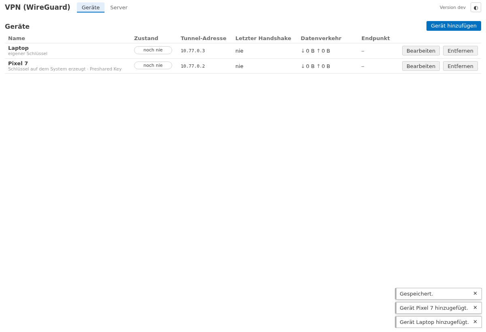
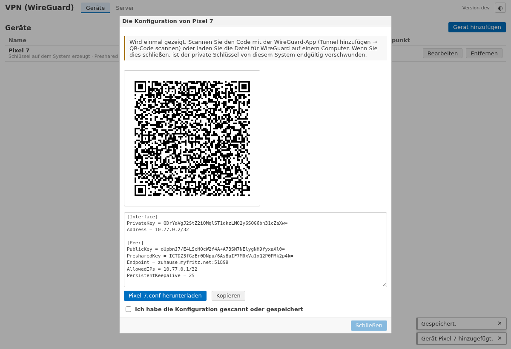
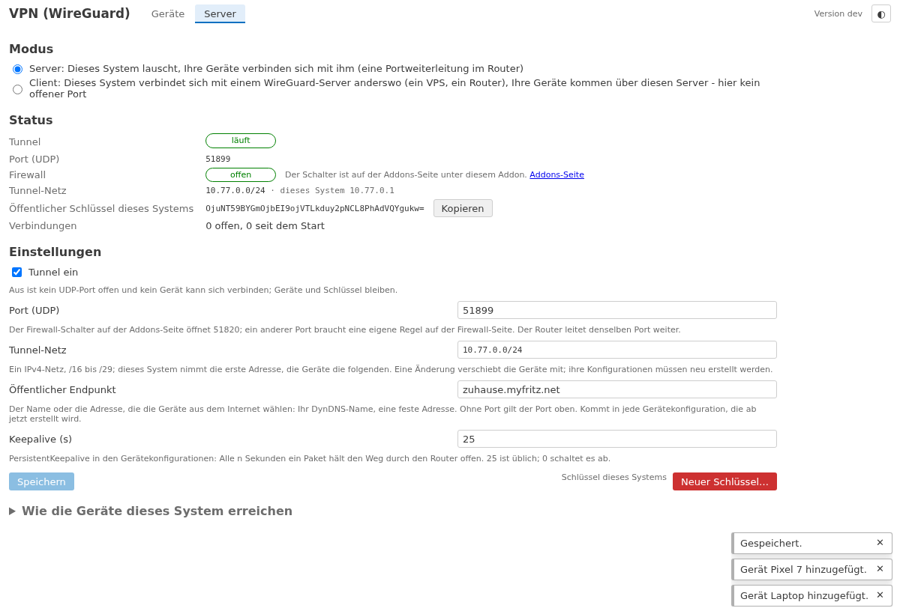

# lite-addon-wireguard

*[Deutsch](README.md)*

**WireGuard remote access** to an [openccu-lite](https://github.com/hobbyquaker/openccu-lite) system: a phone or
laptop reaches the user interface, the APIs and the addon pages from anywhere - and nothing else. WireGuard runs in
userspace inside the addon (wireguard-go with its own network stack): no kernel interface, no privilege, no root. The
tunnel ends inside the addon, which hands the devices' web requests to the web server through the system's **web
ingress**, so the system sees the device's tunnel address and not the loopback.

## What it does

- **Devices:** the key is made on the system and the configuration shown **once** - as a QR code for the WireGuard app
  (Add tunnel → Scan from QR code) and as a file to download. The private key is never stored. Or the device makes its
  own key and you paste its public key; the page then shows the server side for the configuration on the device. Every
  device gets its own tunnel address (`10.77.0.2`, `10.77.0.3`, …), a name and an on/off switch.
- **State per device:** connected (a handshake within the last three minutes), idle, never, disabled; the last
  handshake, bytes received and sent, the public endpoint the device came from, the open connections.
- **Server:** tunnel on/off, the UDP port (51820 by default), the tunnel network (`10.77.0.0/24` by default; this
  system is the first address), the **public endpoint** the devices dial (a DynDNS name or a fixed address), the
  keepalive. The system's public key with a copy button; a new key behind a confirmation (every device then needs a new
  configuration). A how-to for the router's port forward.
- **Only this system is reachable through the tunnel** - the user interface at `http://10.77.0.1/`, the APIs and the
  addon pages. The tunnel encrypts; HTTPS is not needed there. The home network behind the system is not reachable,
  nor is the classic RPC.
- **The page says what is missing:** the UDP port closed on the firewall (the switch is on the Addons page under this
  addon), no endpoint set, the system's backups unencrypted (the server's private key is in them - whoever reads a
  backup can impersonate this system to your devices).
- **No outgoing connections.** The addon listens on one UDP port and answers; it dials nowhere, checks nothing on the
  internet and reports nothing.

## Installation

Needs openccu-lite **1.1.0-dev.6 or newer** (the system's web ingress; on an older system the page says the web server
cannot be reached through the ingress).

1. Install the package `wireguard-<arch>-<version>.tar.gz` from the
   [releases page](https://github.com/hobbyquaker/lite-addon-wireguard/releases) through the system's Addons page.
2. On the Addons page, switch the **port switch** under this addon on: it opens UDP 51820 on the system's firewall.
3. On the **router**, add a port forward of UDP 51820 to the system's LAN address (FRITZ!Box: Internet → Permit Access
   → Port Sharing). Behind DS-Lite or without a public IPv4 this does not work; a later client mode is meant for that.
4. On the addon's page (*VPN (WireGuard)* in the addon menu), under **Server**, enter the **public endpoint** - the
   DynDNS or MyFRITZ! name under which the router is reachable from the internet - and save.
5. Under **Devices**, add a device, scan the QR code with the WireGuard app (or import the file), switch the tunnel on
   in the app. Then open `http://10.77.0.1/` in the device's browser and log in as usual.

## Client mode (0.2.0)

Instead of listening itself, the system connects to a **WireGuard server elsewhere** - a small VPS with WireGuard, a
router with a WireGuard server, OPNsense - and the devices come through that server. No port is open here and no port
forward is needed; it works behind DS-Lite or CGNAT too. On the server, add a peer for this system (a key pair, a tunnel
address such as `10.8.0.5/32`, optionally a preshared key) and import the configuration file the server makes for it
under **Server → Mode → Client** (paste it). The page shows the connection (handshake, traffic), the server, this
system's tunnel address and public key and the networks whose devices may reach it (`AllowedIPs`). The server must
forward the devices' traffic for this system's tunnel address; a device then opens `http://10.8.0.5/`. Here too only
this system is reachable, and the addon makes exactly one outgoing connection: to that server. A server name that does
not resolve at boot is retried every minute.

## How it works

- The tunnel ends in the addon's process (gVisor's network stack from wireguard-go). A device's connections to
  `10.77.0.1:80` are accepted there and handed to the web server's Unix socket that openccu-lite makes for addons with
  `web_ingress` in their manifest (`/run/lighttpd-addons/wireguard/proxy.sock`), with a PROXY protocol header that
  names the device's tunnel address. lighttpd and the system treat the request like one from the LAN from that
  address: the login lockout, API token address ranges and the journal see `10.77.0.2`. The system refuses addresses
  outside the declared tunnel network.
- The manifest declares two blocks as the web ingress: `10.77.0.0/24` (the own network in the server mode) and
  `10.77.1.0/24`. In the client mode the devices come with addresses of the server's network; each is **mapped one to
  one and stably onto an address from `10.77.1.0/24`**, and that is what the system sees - the login lockout, API
  token address ranges and the journal work per device with it; the page shows both addresses. The table lives in
  `addrmap.json` beside the configuration (in the backup); 254 addresses, the device not seen for the longest time
  gives its address up when the block is full. The system refuses addresses outside the two blocks.
- What a device reaches is the addon's decision: the web server alone. There is no route into the LAN and no way to
  the radio interfaces or the classic RPC.
- The configuration (the system's private key, the devices with their public and preshared keys) lives in
  `/usr/local/etc/config/addons/wireguard/wireguard.json` (0600) and is in the system's backup: after a restore every
  device keeps working. Hence the notice to switch backup encryption on.
- A disabled device is no peer any more; a removed one is forgotten. A change to one device never touches the other
  devices' connections.

## Development

`scripts/dev-serve.sh` runs the daemon against a fake system with a stand-in of the web ingress (build `ui/dist`
first with `cd ui && npm run build`); the page is then at `http://127.0.0.1:18298/addons/wireguard/` without the
session check. `go test ./...` covers the keys, the configuration, the PROXY protocol, the API and the tunnel itself
(a second wireguard-go as the peer makes a real handshake and fetches a page through the tunnel);
`WG_DOCKER=1 go test ./test/peer/` additionally runs the official `wireguard-tools` in a container as the peer.
`cd ui && npm test && npx playwright test` covers the page. `scripts/build.sh` builds the packages for aarch64,
x86_64 and armv7l.

[docs/api.md](docs/api.md) describes the page's API. Licence: MIT.
