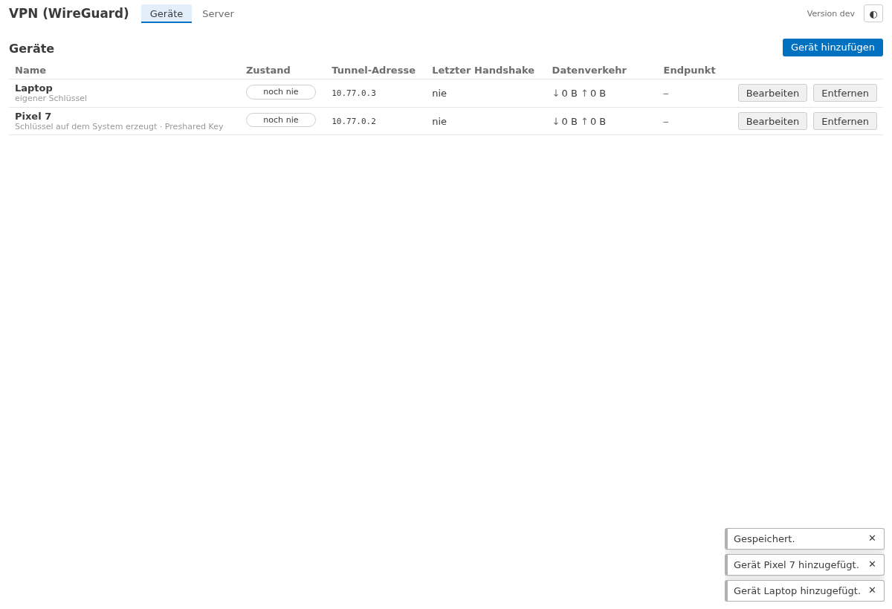
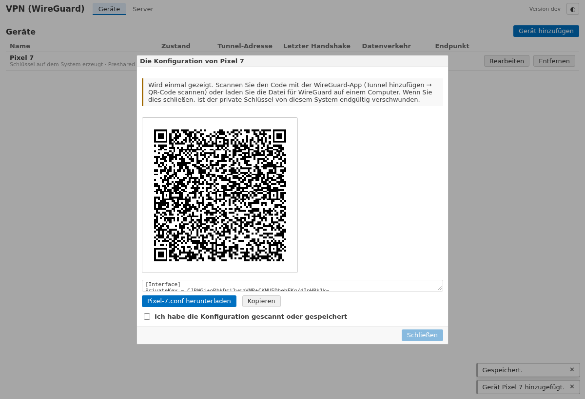
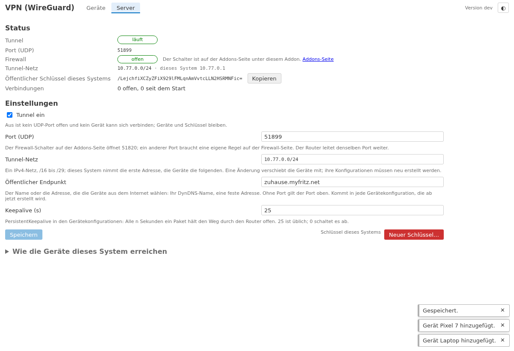

# lite-addon-wireguard

*[English](README.en.md)*

**WireGuard-Fernzugriff** auf ein [openccu-lite](https://github.com/hobbyquaker/openccu-lite)-System: Telefon oder
Laptop erreichen von unterwegs die Oberfläche, die APIs und die Addon-Seiten – und sonst nichts. WireGuard läuft im
Userspace im Addon selbst (wireguard-go mit einem eigenen Netzwerkstack): keine Kernel-Schnittstelle, kein Zusatzrecht,
kein Root. Der Tunnel endet im Addon, das die Web-Anfragen der Geräte über den **Web-Eingang des Systems** an den
Webserver weiterreicht, so dass das System die Tunnel-Adresse des Geräts sieht und nicht den Loopback.

## Was es tut

- **Geräte anlegen:** Der Schlüssel wird auf dem System erzeugt und die Konfiguration **einmal** gezeigt – als QR-Code
  für die WireGuard-App (Tunnel hinzufügen → QR-Code scannen) und als Datei zum Herunterladen. Der private Schlüssel
  wird nie gespeichert. Oder das Gerät erzeugt den Schlüssel selbst und Sie tragen seinen öffentlichen Schlüssel ein;
  die Seite zeigt dann die Serverseite für die Konfiguration auf dem Gerät. Jedes Gerät bekommt eine eigene
  Tunnel-Adresse (`10.77.0.2`, `10.77.0.3`, …), einen Namen und einen Ein/Aus-Schalter.
- **Zustand je Gerät:** verbunden (Handshake in den letzten drei Minuten), inaktiv, noch nie, deaktiviert; letzter
  Handshake, empfangene und gesendete Bytes, der öffentliche Endpunkt, von dem das Gerät kam, offene Verbindungen.
- **Server:** Tunnel ein/aus, UDP-Port (Standard 51820), Tunnel-Netz (Standard `10.77.0.0/24`; dieses System ist die
  erste Adresse), der **öffentliche Endpunkt**, den die Geräte wählen (DynDNS-Name oder feste Adresse), Keepalive. Der
  öffentliche Schlüssel des Systems mit Kopierknopf; ein neuer Schlüssel hinter einer Bestätigung (jedes Gerät braucht
  dann eine neue Konfiguration). Eine Anleitung für die Portweiterleitung im Router.
- **Durch den Tunnel erreichbar ist nur dieses System** – die Oberfläche unter `http://10.77.0.1/`, die APIs und die
  Addon-Seiten. Der Tunnel verschlüsselt; HTTPS ist dort nicht nötig. Das Heimnetz hinter dem System ist nicht
  erreichbar, das klassische RPC auch nicht.
- **Die Seite sagt, was fehlt:** der UDP-Port in der Firewall geschlossen (der Schalter ist auf der Addons-Seite unter
  diesem Addon), kein Endpunkt gesetzt, die Backups des Systems unverschlüsselt (der private Schlüssel des Servers steckt
  darin – wer ein Backup liest, kann sich Ihren Geräten gegenüber als dieses System ausgeben).
- **Keine ausgehenden Verbindungen.** Das Addon lauscht auf einem UDP-Port und antwortet; es wählt nirgendwohin, prüft
  nichts im Internet und meldet nichts.

## Installation

Braucht openccu-lite **1.1.0-dev.6 oder neuer** (den Web-Eingang des Systems; auf einem älteren System meldet die Seite,
dass der Webserver über den Eingang nicht erreichbar ist).

1. Das Paket `wireguard-<arch>-<version>.tar.gz` von der
   [Releases-Seite](https://github.com/hobbyquaker/lite-addon-wireguard/releases) über die Addons-Seite des Systems
   installieren.
2. Auf der Addons-Seite unter diesem Addon den **Port-Schalter** einschalten: Er öffnet UDP 51820 in der Firewall des
   Systems.
3. Im **Router** eine Portweiterleitung UDP 51820 auf die LAN-Adresse des Systems anlegen (FRITZ!Box: Internet →
   Freigaben → Portfreigaben). Hinter DS-Lite oder ohne öffentliche IPv4 funktioniert das nicht; dafür ist ein späterer
   Client-Modus gedacht.
4. Auf der Addon-Seite (*VPN (WireGuard)* im Addon-Menü) unter **Server** den **öffentlichen Endpunkt** eintragen – den
   DynDNS- oder MyFRITZ!-Namen, unter dem der Router aus dem Internet erreichbar ist – und speichern.
5. Unter **Geräte** ein Gerät anlegen, den QR-Code mit der WireGuard-App scannen (oder die Datei importieren), den
   Tunnel in der App einschalten. Dann `http://10.77.0.1/` im Browser des Geräts öffnen und wie gewohnt anmelden.

## Wie es funktioniert

- Der Tunnel endet im Prozess des Addons (gVisors Netzwerkstack aus wireguard-go). Verbindungen eines Geräts zu
  `10.77.0.1:80` nimmt das Addon dort an und reicht sie an den Unix-Socket des Webservers weiter, den openccu-lite für
  Addons mit `web_ingress` im Manifest anlegt (`/run/lighttpd-addons/wireguard/proxy.sock`), mit einem PROXY-Protocol-
  Header, der die Tunnel-Adresse des Geräts nennt. lighttpd und das System behandeln die Anfrage wie eine aus dem LAN
  von dieser Adresse: Anmeldesperre, Adressbereiche von API-Tokens und das Journal sehen `10.77.0.2`. Adressen außerhalb
  des deklarierten Tunnel-Netzes nimmt das System nicht an.
- Was ein Gerät erreicht, bestimmt das Addon: nur den Webserver. Es gibt keine Route ins LAN und keinen Weg zu den
  Funkschnittstellen oder zum klassischen RPC.
- Die Konfiguration (der private Schlüssel des Systems, die Geräte mit ihren öffentlichen und Preshared Keys) liegt in
  `/usr/local/etc/config/addons/wireguard/wireguard.json` (0600) und ist im Backup des Systems: Nach einer
  Wiederherstellung funktionieren alle Geräte weiter. Deshalb der Hinweis, die Backup-Verschlüsselung einzuschalten.
- Ein deaktiviertes Gerät ist kein Peer mehr; ein entferntes ist vergessen. Eine Änderung an einem Gerät berührt die
  Verbindungen der anderen nicht.

## Entwicklung

`scripts/dev-serve.sh` startet den Daemon gegen ein Fake-System mit einem Stellvertreter des Web-Eingangs
(`ui/dist` vorher mit `cd ui && npm run build` bauen); die Seite ist dann unter
`http://127.0.0.1:18298/addons/wireguard/` ohne Sitzungsprüfung. `go test ./...` prüft Schlüssel, Konfiguration,
PROXY-Protokoll, API und den Tunnel selbst (ein zweites wireguard-go als Gegenstelle macht einen echten Handshake und
holt eine Seite durch den Tunnel); `WG_DOCKER=1 go test ./test/peer/` lässt zusätzlich die offiziellen
`wireguard-tools` in einem Container als Gegenstelle laufen. `cd ui && npm test && npx playwright test` prüft die Seite.
`scripts/build.sh` baut die Pakete für aarch64, x86_64 und armv7l.

[docs/api.md](docs/api.md) beschreibt die API der Seite. Lizenz: MIT.
